# Отчёт

## Контекст

Учебный проект Школы 21 по направлению «Кибербезопасность». Работа выполнялась в изолированной лабораторной среде на Ubuntu 22.04, запущенной в VirtualBox. Сетевая инфраструктура моделировалась в GNS3 с маршрутизаторами Cisco 3745, конфигурация выполнялась через Cisco IOS CLI. Трафик захватывался и анализировался в Wireshark.

## Цель работы

Настроить сетевые устройства и службы, проверить взаимодействие узлов и разобрать обмен пакетами для нескольких сетевых протоколов.

Выполнено пять практических сценариев: Static Routing, NTP, DNS, DHCP и SSH. Доступность настроенных сервисов проверялась на устройствах, сетевой обмен исследовался в Wireshark.

## Окружение и инструменты

| Компонент | Назначение |
|---|---|
| Ubuntu 22.04 | Операционная система лабораторной среды |
| VirtualBox | Запуск виртуальной машины |
| GNS3 | Эмуляция сетевой топологии |
| Cisco 3745 | Маршрутизаторы лабораторной сети |
| Wireshark | Захват и анализ сетевого трафика |

## 1. Static Routing

### Выполненная работа

В GNS3 собрана топология из трёх последовательно соединённых маршрутизаторов Cisco: R1 — R2 — R3. Настроены IP-интерфейсы и статические маршруты для обмена трафиком между удалёнными сетями.

Связность проверена с помощью ICMP (`ping`). Трасса открыта в Wireshark для разбора ICMP Echo Request и Echo Reply.

### Результат

- Топология из трёх маршрутизаторов создана и запущена.
- Статические маршруты настроены, связность между узлами подтверждена.
- ICMP-трафик захвачен и разобран.

### Скриншоты

**Топология GNS3**

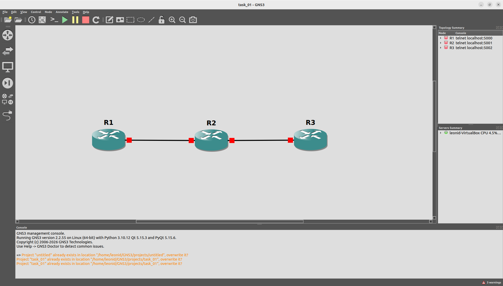

**Таблица маршрутизации**

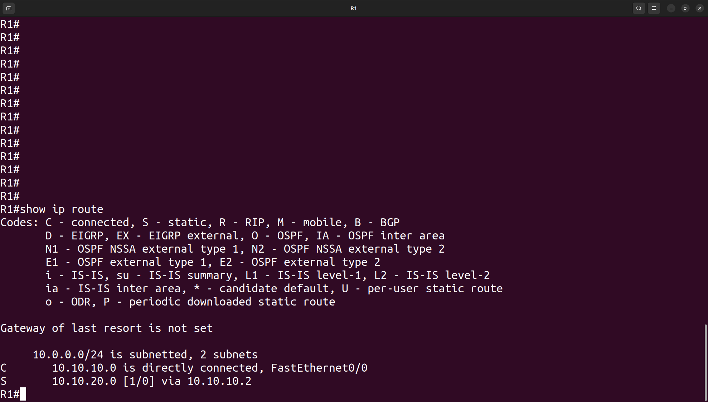

**ICMP-трафик в Wireshark**

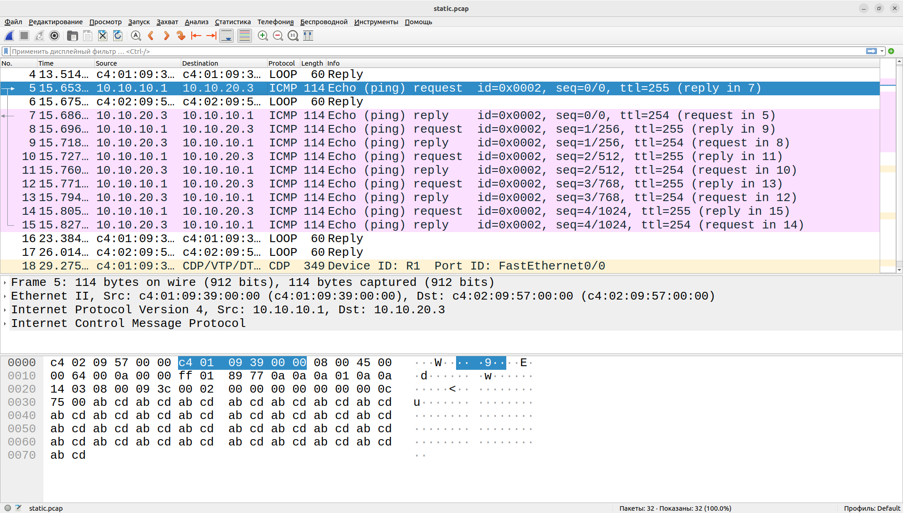

## 2. NTP

### Выполненная работа

На сетевых устройствах настроена служба NTP: одно устройство работает как сервер времени, другое как клиент. Синхронизация времени проверена после настройки.

NTP-трафик захвачен и открыт в Wireshark. В выбранном пакете рассмотрены поля протокола и временные метки, включая Transmit Timestamp.

### Результат

- Обмен временем между NTP-сервером и клиентом настроен, синхронизация подтверждена.
- NTP-трафик захвачен, разобраны структура пакета и его временные поля.

На скриншоте Wireshark видны NTP-пакеты версии 3 и поля временных меток.

### Скриншот

**Анализ NTP-пакета в Wireshark**

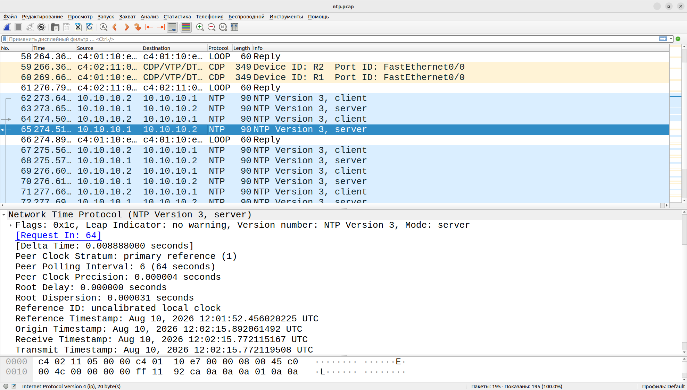

## 3. DNS

### Выполненная работа

На сетевом устройстве настроена DNS-запись для тестового имени `my.site`, на клиентском устройстве настроено использование DNS-службы.

Разрешение имени проверено командой `ping my.site`. В Wireshark разобраны DNS-запрос и ответ, включая тип записи и класс запроса, а также последующий ICMP-обмен.

### Результат

- DNS-запись для тестового имени добавлена, разрешение имени в IP-адрес подтверждено.
- DNS-запрос и ответ захвачены, разобраны поля пакетов и связанный ICMP-трафик.

### Скриншоты

**Проверка DNS-записи на сетевом устройстве**

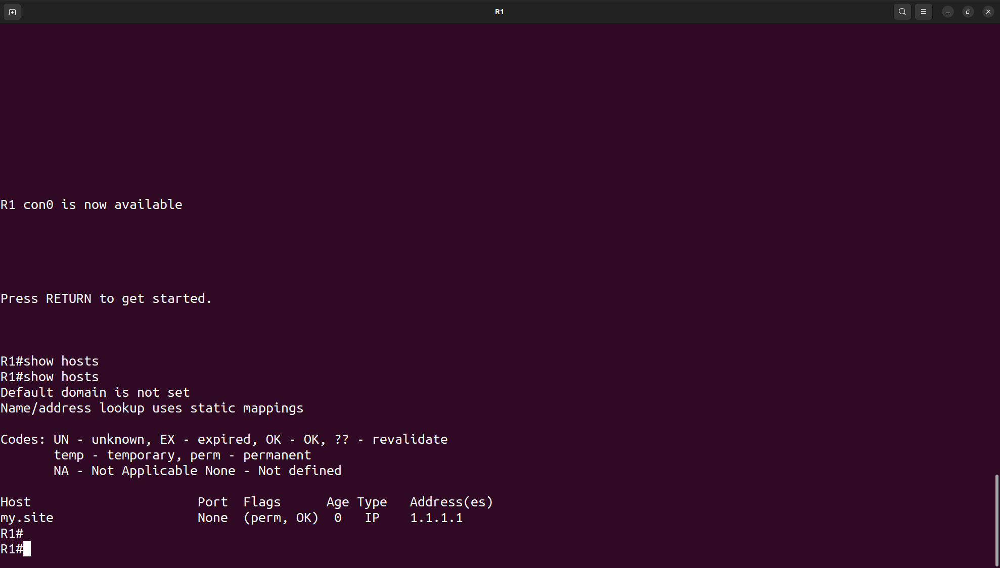

**DNS-запрос и ответ в Wireshark**

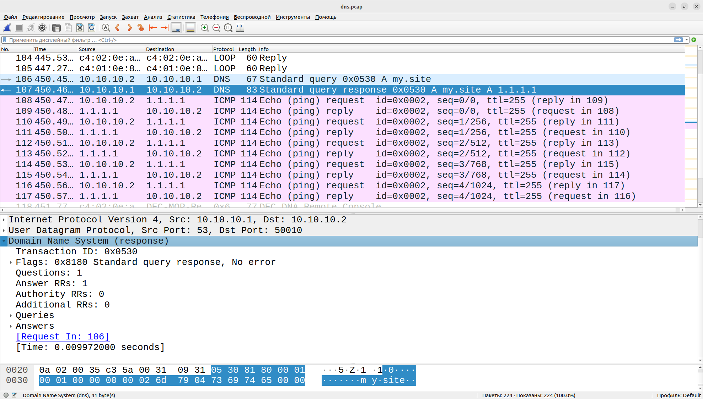

## 4. DHCP

### Выполненная работа

В GNS3 к маршрутизатору Cisco подключён виртуальный компьютер VPCS. На маршрутизаторе настроены интерфейс и DHCP-сервер для автоматической выдачи сетевых параметров клиенту.

Клиент запросил параметры по DHCP. В Wireshark разобран обмен пакетами, соответствующий последовательности DORA: Discover, Offer, Request, Acknowledge.

### Результат

- Топология с маршрутизатором Cisco и VPCS создана.
- DHCP-сервер и пул адресов настроены, получение параметров клиентом подтверждено.
- DHCP-трафик захвачен и разобран, включая последовательность DORA.

### Скриншоты

**Топология DHCP в GNS3**

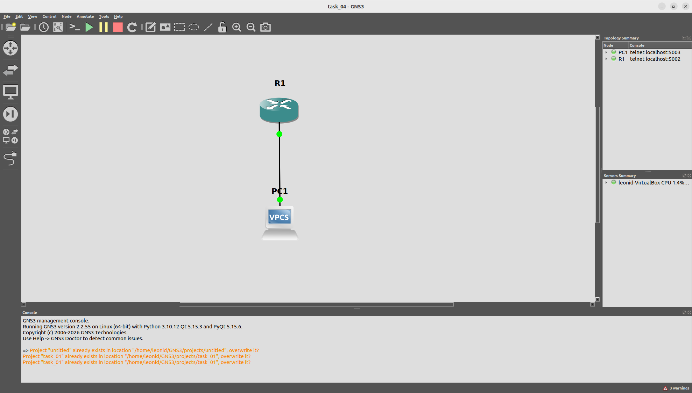

**DHCP DORA в Wireshark**

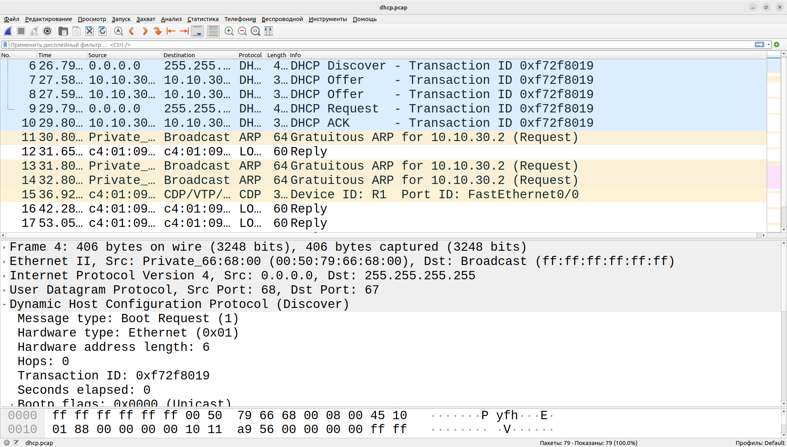

## 5. SSH

### Выполненная работа

На маршрутизаторе Cisco настроен SSH для удалённого администрирования: создан пользователь, сгенерированы RSA-ключи, настроены VTY-линии для подключения по SSH.

Проверена доступность TCP-порта 22 и выполнено удалённое подключение. В Wireshark разобраны TCP Three-Way Handshake и последующий обмен SSH-пакетами, включая согласование ключей и зашифрованный трафик.

Отдельно разобраны различия между Telnet и SSH с точки зрения защиты данных: Telnet не шифрует содержимое соединения, SSH шифрует удалённую сессию.

### Результат

- SSH включён, локальная учётная запись создана, RSA-ключи сгенерированы, доступ через VTY настроен.
- Подключение по SSH выполнено.
- В Wireshark разобраны TCP Three-Way Handshake и SSH-трафик.

### Скриншоты

**Конфигурация SSH**

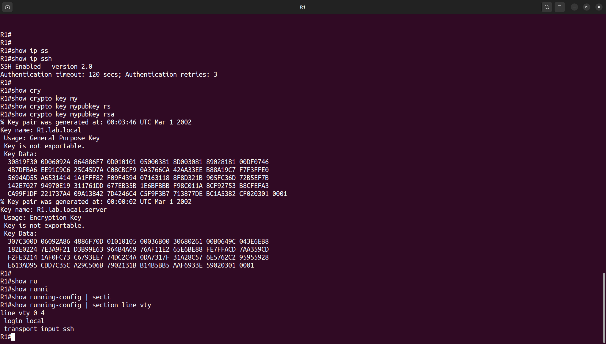

**TCP Three-Way Handshake**

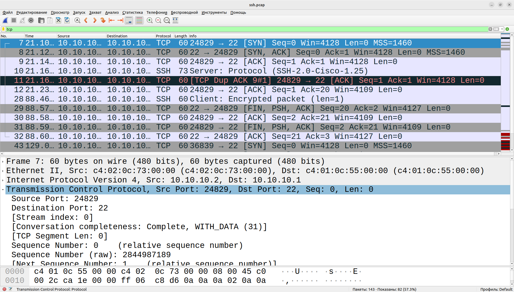

**Анализ SSH-трафика**

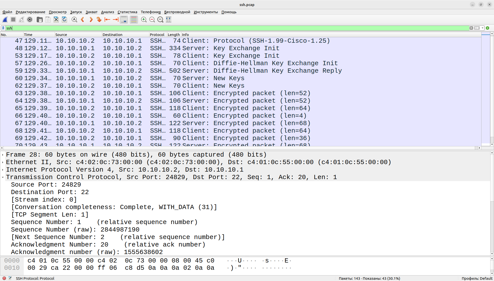

## В проекте разобраны:

- ICMP-трафик при проверке связности;
- NTP-пакеты и временные метки;
- DNS-запросы и ответы;
- DHCP-обмен DORA;
- TCP Three-Way Handshake;
- установление SSH-соединения и зашифрованный обмен;
- различия между Telnet и SSH.

## Выводы

- Было выполнено: статическая маршрутизация, NTP, DNS, DHCP и SSH настроены на оборудовании Cisco и проверены в лабораторной среде.
- Сетевой обмен каждого сервиса захвачен и разобран в Wireshark.
- Telnet и SSH сопоставлены с точки зрения защиты передаваемых данных.
